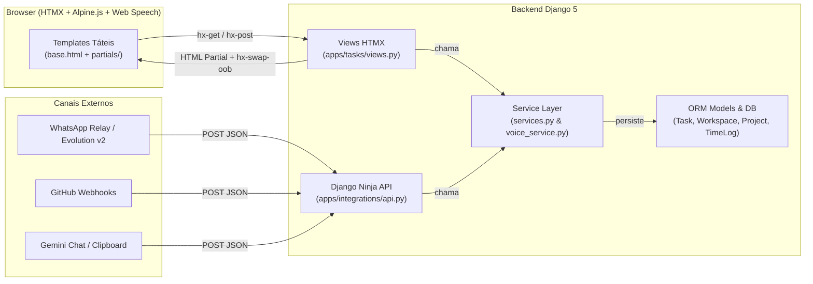
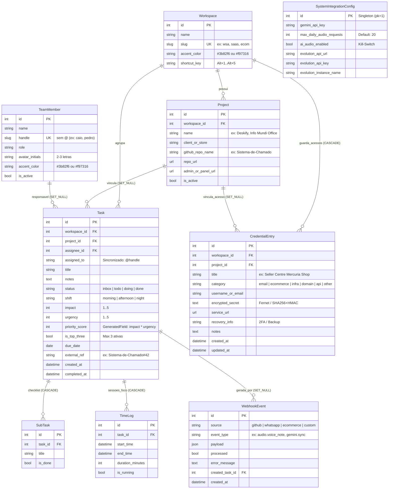

# CONTEXTO_SISTEMA.md — Command Center (Dev & Ops Portal)

> **Propósito deste Documento:**
> 1. **System Prompt / LLM Context:** Base de conhecimento técnica e determinística para que agentes de IA compreendam a arquitetura, modelos, endpoints, regras de negócio e o Design System Tátil sem alucinar.
> 2. **Guia de Arquitetura e Manutenção:** Mapa mental completo de pastas, fluxos de dados, automações e roadmap de evolução.

---

## 1. Visão Geral e Propósito (System Overview)

O **Command Center (Dev & Ops Portal)** é um hub centralizado de operações, gestão de tarefas por prioridade matemática (`Impacto × Urgência`), controle de tempo (`TimeLog`) e ingestão omnichannel de demandas (Barra de Comando `Ctrl + K`, Ditado por Voz Nativo, Áudio Multimodal Gemini, WhatsApp Relay / Evolution API v2, GitHub Webhooks e Alertas de E-commerce Shopee/Mercado Livre).

### Problema Central que Resolve
Elimina a dispersão de contexto entre múltiplas frentes de trabalho (**WSA Creative**, **SaaS & Dev**, **E-commerce**, **Faculdade SI** e **Indie Games**), aplicando:
- **Regra Estrita de Foco ("Top 3 do Dia"):** No máximo **3 tarefas ativas** (`status != 'done'`) podem ocupar os slots de prioridade máxima simultaneamente. Promover uma 4ª tarefa rebaixa automaticamente a mais antiga do Top 3.
- **Fila Operacional por Turnos (`Manhã - Deep Work`, `Tarde - Ops/E-com`, `Noite - Estudos/Games`)** e **Fila por Ordem de Chegada (`FIFO` / `LIFO`)**.
- **Captura de Atrito Zero:** Comandos rápidos via teclado (`Ctrl + K`), colagem em 1 clique do chat do Gemini (`⚡ Sync Gemini`), ditado por voz gratuito no navegador (`🎙️ Ditado`) e mensagens/áudios citados no WhatsApp (`/task`, `!cc`, `/gemini`).

### Stack Tecnológica Completa

| Camada | Tecnologia / Biblioteca | Papel no Sistema |
| :--- | :--- | :--- |
| **Backend Core** | **Python 3.12+ / Django 5.2** (`config/`, `apps/`) | ORM, SSR, Views HTMX, Signals, Admin e regras de negócio |
| **API & Webhooks** | **Django Ninja 1.3+** (`apps/integrations/api.py`) | API REST tipada (Pydantic Schemas) e ingestão de Webhooks (`/api/docs`) |
| **Frontend / Hipermídia** | **HTMX 1.9.12 + Alpine.js 3.14 + SortableJS 1.15** | Atualizações parciais de DOM, Out-of-Band (`hx-swap-oob`), micro-estados reativos e Drag-and-Drop |
| **Design System** | **Tactile / Soft-Neumorphic UI + Tailwind CSS CDN** | Física de elevação em 5 níveis, cavidades `.ds-layer-inset` e motor Dual-Theme (`tactile-dark` / `tactile-sand`) em `static/css/tactile-ds.css` |
| **Banco de Dados** | **PostgreSQL (`psycopg 3`) / SQLite3 Fallback** | Persistência relacional com `GeneratedField` nativo no banco para `priority_score = impact * urgency` |
| **Filas & Agendamento** | **Celery 5.4 + Redis 5.0** (`config/celery.py`) | Processamento assíncrono de webhooks (com fallback síncrono `CELERY_TASK_ALWAYS_EAGER`) e rotina diária às 06:00 |
| **Segurança & Cofre** | **Cryptography (Fernet / SHA-256 + HMAC) + Single-Tenant Auth** | Criptografia de credenciais (`CredentialEntry`) e middleware de proteção global (`CommandCenterAuthMiddleware`) |
| **IA & Voz (Custo Zero)** | **Web Speech API + MediaRecorder + Gemini 2.5 Flash REST** | Ditado PT-BR ilimitado no browser e decomposição multimodal de áudio/subtarefas com 3 travas rígidas de cota |
| **Conector WhatsApp** | **Node.js + `whatsapp-web.js` (`whatsapp_relay/`)** | Microsserviço local opcional que escuta `message_create` no próprio WhatsApp e encaminha comandos/áudios |
| **Produção & Deploy VPS** | **Gunicorn 23 + WhiteNoise 6 + PM2 (`ecosystem.config.js`)** | Servidor WSGI em `127.0.0.1:8005`, arquivos estáticos comprimidos e script `./deploy.sh` |

---

## 2. Mapa de Diretórios e Arquitetura

### Árvore de Diretórios Comentada

```text
Command Center (Dev & Ops Portal)/
├── manage.py                          # Entrypoint CLI do Django
├── requirements.txt                   # Dependências Python (Django 5, django-ninja, celery, redis, psycopg, cryptography, gunicorn, whitenoise)
├── .env.example                       # Template de variáveis de ambiente
├── ecosystem.config.js                # Orquestração PM2 na VPS (cc-web na porta 8005, cc-celery-worker, cc-celery-beat)
├── deploy.sh                          # Script automatizado de deploy na VPS Ubuntu (/var/www/command-center)
├── config/                            # Configuração central do projeto Django
│   ├── settings.py                    # Configuração DB (dj-database-url), WhiteNoise, Celery, Auth Guard, Tokens e Chaves API
│   ├── urls.py                        # Roteador raiz (/login/, /logout/, /admin/, /api/, /timetracker/, /)
│   ├── celery.py                      # Instância Celery + Beat Schedule (06:00 daily priority recalculation)
│   ├── wsgi.py / asgi.py              # Entrypoints de produção
├── apps/
│   ├── core/                          # Entidades estruturais, parsers, segurança e serviços transversais
│   │   ├── models.py                  # Workspace, Project, TeamMember, SystemIntegrationConfig, CredentialEntry (Vault)
│   │   ├── middleware.py              # CommandCenterAuthMiddleware (Single-Tenant Guard quando REQUIRE_AUTH=True)
│   │   ├── services.py                # Command Parser (Ctrl+K) + Motor Dual Sync (Gemini JSON / Multi-line / 1-line)
│   │   ├── voice_service.py           # Motor de Voz PT-BR, Gemini 2.5 Flash Audio REST, Fetcher Evolution API e Travas 1-3
│   │   ├── admin.py                   # Registro no Django Admin
│   │   ├── tests.py                   # Suíte completa com 22 testes integrados (Fases 1 a 9)
│   │   └── management/commands/
│   │       └── seed_command_center.py # Popula 5 Workspaces, 6 Projetos, 4 TeamMembers, 8 Tasks e 4 Credenciais no Cofre
│   ├── tasks/                         # Domínio principal de Tarefas, Subtarefas e Views HTMX
│   │   ├── models.py                  # Task (com GeneratedField priority_score e regra Top 3) e SubTask
│   │   ├── views.py                   # Views do Dashboard, 8 modos de visão, CRUD dinâmico, Cofre (Vault) e fragmentos OOB
│   │   ├── urls.py                    # Rotas de interface e endpoints HTMX (namespace 'tasks')
│   │   └── tasks.py                   # Task Celery: recalculate_daily_priorities()
│   ├── timetracker/                   # Domínio de Cronômetro Global e Logs de Tempo
│   │   ├── models.py                  # TimeLog (start_time, end_time, duration_minutes, is_running)
│   │   ├── views.py                   # Play/Stop exclusivo, adição manual (+15m) e exclusão de logs
│   │   └── urls.py                    # Rotas de cronômetro (namespace 'timetracker')
│   └── integrations/                  # Ingestão de Webhooks Externos e Auditoria
│       ├── models.py                  # WebhookEvent (histórico auditável com payload JSON e created_task)
│       ├── api.py                     # Endpoints Django Ninja (/api/webhooks/gemini, whatsapp, evolution, github, ecommerce)
│       └── tasks.py                   # Workers de processamento de eventos (GitHub lifecycle, WhatsApp, E-commerce)
├── static/
│   └── css/
│       └── tactile-ds.css             # Folha de estilos mestre do Tactile / Soft-Neumorphic Design System
├── templates/                         # Templates SSR + Fragmentos HTMX
│   ├── base.html                      # Shell global: Sidebar, Header, Barra Ctrl+K, Ditado, Modal Áudio IA, Alpine root
│   ├── login.html                     # Tela de Login Tátil do Single-Tenant Guard (/login/)
│   ├── dashboard.html                 # Wrapper da view principal que inclui partials/dashboard_content.html
│   └── partials/                      # Componentes modulares atualizados via HTMX
│       ├── dashboard_content.html     # Orquestrador central das 8 visões + Swaps OOB (Out-of-Band)
│       ├── context_bar.html           # Faixa de filtro por Frente (#slug) + Alternador das 8 Visões
│       ├── sidebar_content.html       # Navegação lateral, contadores por Frente e Launchpad 1-Click
│       ├── top_three.html             # Painel "Top 3 do Dia" (máx 3 cards ativos + cavidades de slots vazios)
│       ├── shift_queue.html           # Colunas de Turnos (Manhã, Tarde, Noite) com SortableJS
│       ├── shift_task_card.html       # Card individual de tarefa nos turnos
│       ├── list_view.html             # Visão em Lista (/?view=list) com Ordem de Chegada (FIFO/LIFO) e sort por coluna
│       ├── kanban_board.html          # Quadro Kanban em 4 colunas (Inbox, A Fazer, Em Execução, Concluída)
│       ├── inbox_list.html            # Seção de Triagem de Webhooks + Simulador 1-Click
│       ├── task_detail_drawer.html    # Gaveta Lateral (Slide-Over): Notas, Subtarefas, IA Breakdown e TimeLogs
│       ├── assignee_chip_popover.html # Chip circular @handle com Popover de atribuição/remoção em 1 clique
│       ├── active_timer.html          # Widget de cronômetro vivo no Header
│       ├── command_bar_tags.html      # Pílulas de sugestão abaixo do input Ctrl+K
│       ├── analytics_view.html        # Visão Pulso & Métricas (barras de horas por Frente/Projeto e histórico)
│       ├── integrations_view.html     # Visão Integrações & Logs (Sync Gemini, Travas de Voz/Cota, Tabela de Webhooks)
│       ├── vault_view.html            # Visão Cofre & Senhas (/?view=vault): Alternância Grade (Cards) / Lista Compacta
│       ├── settings_view.html         # Visão Gestão & Cadastros (CRUD de Frentes, Projetos/Lojas e Equipe)
│       └── styleguide_view.html       # Documentação viva e interativa do Tactile Design System (/?view=styleguide)
└── whatsapp_relay/                    # Conector Node.js standalone para WhatsApp Web
    ├── package.json                   # Dependências Node (whatsapp-web.js, qrcode-terminal, dotenv)
    └── index.js                       # Listener de comandos (/task, !cc, /gemini) e Quote explícito de áudio
```

### Padrão Arquitetural (Server-Driven Hypermedia + Service Layer)
O sistema adota **Server-Driven UI com HTMX (Hypermedia-Oriented Architecture)** combinado com uma **Camada de Serviços (`Service Layer`)** desacoplada:



1. **Views Magras (`apps/tasks/views.py` e `apps/timetracker/views.py`):** Recebem requisições HTMX, delegam mutações aos modelos/serviços e sempre retornam `render_dashboard_or_partial(request, ...)` ou `render_drawer_with_oob(request, ...)`.
2. **Sincronização Global via Out-of-Band Swaps (`hx-swap-oob`):** Quando qualquer mutação ocorre no `#dashboard-content`, o template `partials/dashboard_content.html` (quando `is_htmx_oob=True`) injeta blocos `hx-swap-oob` que atualizam simultaneamente a barra de contexto (`#workspace-context-bar`), a sidebar (`#sidebar-desktop-container`), o cronômetro ativo (`#active-timer-container`) e as tags do `Ctrl + K` (`#command-bar-tags-container`), sem recarregar a página.
3. **Service Layer Reutilizável (`apps/core/services.py` e `apps/core/voice_service.py`):** A mesma lógica de parsing atende tanto a barra `Ctrl + K` na web quanto os webhooks do WhatsApp, Gemini e transcrições de voz.

---

## 3. Fluxos Principais e Regras de Negócio (Core Workflows)

### Fluxo 1: Motor de Prioridade Matemática e Regra Estrita do "Top 3 do Dia"
- **Onde reside:** `apps/tasks/models.py` (`Task`, método `Task.save()`, linhas 128–160) e `apps/tasks/tasks.py` (`recalculate_daily_priorities()`).
- **Cálculo Nativo no Banco (`GeneratedField`):**
  - `priority_score = models.GeneratedField(expression=F("impact") * F("urgency"), output_field=models.PositiveSmallIntegerField(), db_persist=True)`
  - Escala de `1` (`1×1`) a `25` (`5×5`).
- **Invariante do Top 3:**
  - Sempre que uma `Task` é salva com `is_top_three=True` e `status != 'done'`, o método `Task.save()` busca todas as outras tarefas ativas com `is_top_three=True` ordenadas por `("created_at", "pk")`.
  - Se já existirem 3 ou mais tarefas no Top 3, a mais antiga (`oldest_task`) tem seu `is_top_three` alterado para `False` no banco e seu título é salvo em `self._demoted_task_title` para exibir um alerta na UI.
  - Se uma tarefa for marcada como `status == 'done'`, ela recebe `completed_at = timezone.now()` e `is_top_three = False` automaticamente.

### Fluxo 2: Command Parser (`Ctrl + K`) e Ponte Dupla Gemini + WhatsApp
- **Onde reside:** `apps/core/services.py` (`parse_and_create_task()` nas linhas 84–180 e `process_gemini_or_whatsapp_sync()` nas linhas 300–530).
- **Tags extraídas via Regex de qualquer comando textual:**
  - `#slug` (`WORKSPACE_TAG_RE`): Vincula à frente correspondente (`#wsa`, `#saas`, `#ecom`, `#facul`, `#games`) ou cria se for um slug padrão.
  - `@handle` (`ASSIGNEE_TAG_RE`): Vincula ao `TeamMember` correspondente (`@caio`, `@pedro`, `@henrique`, `@monica`). Se o handle ainda não existir na tabela `TeamMember`, `Task._sync_assignee_and_assigned_to()` cria o registro automaticamente.
  - `!top3` (`TOP3_TAG_RE`): Define `impact=5`, `urgency=5`, `is_top_three=True`.
  - `!hoje` (`TODAY_TAG_RE`): Define `urgency=5` e `due_date=date.today()`.
  - `!i1`..`!i5` e `!u1`..`!u5`: Define impacto e urgência explícitos.
  - `/manha`, `/tarde`, `/noite` (`SHIFT_TAG_RE`): Define o turno (`morning`, `afternoon`, `night`).
- **Detecção Automática de Projeto (`detect_project_for_workspace`):** Inspeciona palavras-chave no título (ex: `"deskify"` $\rightarrow$ Projeto *Deskify*; `"infomundi"` / `"mercado livre"` $\rightarrow$ *Info Mundi Office*; `"mercuria"` / `"shopee"` $\rightarrow$ *Mercuria Shop*; `"mscrew"` $\rightarrow$ *Portal MS CREW*).
- **Os 3 Formatos Aceitos por `process_gemini_or_whatsapp_sync()`:**
  1. **Formato A (JSON Estruturado do Gemini):** Dicionário ou string JSON (mesmo dentro de blocos Markdown ```` ```json ... ``` ````) com chaves `action` (`upsert` ou `complete`), `title`, `workspace`, `project`, `assignee`, `shift`, `impact`, `urgency`, `is_top_three`, `minutes_spent`, `notes`, `subtasks`.
  2. **Formato B (Bloco Multi-linha WhatsApp/Gemini):** Primeira linha com comando + linhas subsequentes contendo metadados (`Projeto: ...`, `Tempo: 45m`, `Responsável: @...`, checklist `- [ ] item` ou `- [x] item` e `Notas: ...`).
  3. **Formato C (Comando Rápido de 1 Linha):** Texto direto com tags (se vier de `source="whatsapp"` sem `!top3` ou `!hoje`, entra em `status="inbox"`; caso contrário, entra em `status="todo"`).

### Fluxo 3: Motor Híbrido de Voz & Áudio IA com 3 Travas Rígidas de Segurança
- **Onde reside:** `apps/core/voice_service.py`, `apps/integrations/api.py` (`webhook_whatsapp_evolution` e `webhook_whatsapp_audio`) e `whatsapp_relay/index.js`.
- **Ditado Nativo (`normalize_spoken_command_ptbr`):** Converte expressões faladas no microfone do navegador (`Web Speech API`, 100% gratuito e sem usar cota) como *"frente wsa responsável pedro top 3 para hoje turno da tarde"* em `#wsa @pedro !top3 !hoje /tarde`.
- **As 3 Travas Rígidas para Áudio IA (`process_audio_with_gemini_free_tier`):**
  1. **Trava 1 — Gatilho Exclusivo por Resposta Explícita (`Explicit Quote Trigger`):** Áudios soltos no WhatsApp são 100% ignorados (`status: "ignored_safety_lock_no_trigger"`). Um áudio só é processado se o usuário **responder (quote)** à mensagem de áudio enviando `/task`, `!cc` ou `/gemini`. Na Evolution API v2, quando o quote vem sem Base64 embutido, `fetch_quoted_audio_from_evolution()` busca o binário via `POST /chat/getBase64FromMediaMessage/{instance}` usando `contextInfo.stanzaId`.
  2. **Trava 2 — Limite de Payload (`MAX_AUDIO_BYTES = 3_500_000`):** Qualquer áudio maior que **3.5 MB** (~2 min) é rejeitado imediatamente (`status: "blocked_payload_too_large"`).
  3. **Trava 3 — Disjuntor de Cota Diária & Kill-Switch (`get_daily_audio_quota_status`):** Conta quantos `WebhookEvent(event_type="audio.voice_note", processed=True)` ocorreram desde `00:00` (horário local). Se `ai_audio_enabled == False` ou `used_today >= max_daily_audio_requests` (padrão `20/dia`), bloqueia chamadas externas (`status: "blocked_daily_quota_exceeded"`).

### Fluxo 4: Ciclo de Vida Completo de Issues/PRs do GitHub e Pausa Automática de Timer
- **Onde reside:** `apps/integrations/tasks.py` (`process_github_webhook()`, linhas 139–245).
- **Abertura (`opened` / `reopened`):** Mapeia `repository.name` ao `Project.github_repo_name` (ex: `Sistema-de-Chamado` $\rightarrow$ *Deskify*), cria ou atualiza a `Task` usando `external_ref = "Repo#Numero"` com `impact=4, urgency=4`.
- **Fechamento/Merge (`closed`):** Localiza a `Task` pelo `external_ref`, marca `status = Task.Status.DONE`, retira do Top 3 e **encerra automaticamente qualquer `TimeLog` que esteja rodando (`is_running=True`) para aquela tarefa**, contabilizando os minutos trabalhados.

### Fluxo 5: Cronômetro Global Exclusivo (`TimeTracker`)
- **Onde reside:** `apps/timetracker/views.py` (`start_timer_view`, `stop_timer_view`, `add_manual_time_view`).
- **Exclusividade Atômica:** Ao dar Play em uma tarefa (`POST /timetracker/start/<task_id>/`), dentro de `transaction.atomic()` com `select_for_update()`, o sistema pausa qualquer outro `TimeLog` ativo (`running_log.stop()`), move a tarefa anterior de `doing` para `todo`, muda a nova tarefa para `doing` e inicia um novo `TimeLog(is_running=True)`.

### Fluxo 6: Cofre de Credenciais & Acessos Criptografado (`Vault` — Fase 8 & 8.1)
- **Onde reside:** `apps/core/models.py` (`CredentialEntry`, `encrypt_vault_secret()`, `decrypt_vault_secret()`), `apps/tasks/views.py` (`vault_credential_save_view`, `vault_credential_delete_view`, `vault_credential_secret_view`) e `templates/partials/vault_view.html`.
- **Criptografia Simétrica Autenticada (`Fernet` / `SHA-256 + HMAC`):**
  - `CredentialEntry.set_secret(raw_secret)` criptografa a senha antes de persistir em `encrypted_secret` usando chave de 32 bytes derivada de `VAULT_ENCRYPTION_KEY` (ou fallback determinístico via `hashlib.sha256(settings.SECRET_KEY)` + `base64.urlsafe_b64encode`).
  - `CredentialEntry.get_secret()` descriptografa o token sob demanda.
- **Zero Senhas Expostas no DOM Inicial & Alternância Grade / Lista:**
  - A visão `/?view=vault` renderiza apenas `••••••••••••••` no HTML estático, tanto na **Visualização em Grade (`#vault-grid-container`)** quanto na **Visualização em Lista Compacta (`#vault-list-container`)**, cuja preferência é persistida em `localStorage.getItem('cc-vault-layout')` (`'grid'` ou `'list'`).
  - Quando o usuário clica em `👁 Ver` ou `📋 Senha`, o componente Alpine.js requisita `GET /vault/<pk>/secret/` via `fetch()` para revelar ou copiar o segredo na área de transferência. O formulário também inclui um gerador criptográfico de senhas fortes de 16 caracteres (`window.crypto.getRandomValues`).

---

## 4. Modelagem de Dados e Estado

### Diagrama Entidade-Relacionamento (ERD)



### Sincronização Bidirecional de Responsável e Deleção Segura
- **`Task._sync_assignee_and_assigned_to()` (`apps/tasks/models.py`):** Mantém o campo legado `assigned_to` (`"@pedro"`) e a ForeignKey `assignee` (`TeamMember`) 100% sincronizados em qualquer `save()`.
- **Signal `pre_delete` em `TeamMember` (`apps/core/models.py`, linha 137):** Ao excluir um membro da equipe, limpa `assignee=None` e `assigned_to=""` em todas as suas tarefas antes do delete.
- **Exclusão Segura de `Workspace` (`apps/tasks/views.py`, `workspace_delete_view`):** Ao excluir uma frente que possui tarefas, migra automaticamente as tarefas órfãs para outra frente ativa (a menos que `delete_tasks=1` seja enviado).

### Gerenciamento de Estado no Frontend (`templates/base.html`)
- **Alpine.js (`commandCenterApp()` em `templates/base.html`):**
  - `theme`: Persistido em `localStorage.getItem('cc-tactile-theme')` (`'tactile-dark'` por padrão ou `'tactile-sand'`), aplicado no atributo `data-theme` do `<html>`.
  - `sidebarOpen`: Estado do drawer de navegação mobile.
  - `isDictating`, `audioModalOpen`, `isRecordingAudio`, `recordingSeconds`: Estados da captura de voz (`SpeechRecognition` e `MediaRecorder`).
- **SortableJS (`initAllSortables()` em `templates/base.html`):**
  - Re-inicializado automaticamente após qualquer `htmx:afterSwap`.
  - Habilita Drag-and-Drop entre turnos (`[data-sortable-shift]`) e entre colunas do Kanban (`[data-sortable-kanban]`), disparando `POST /tasks/<id>/move/` via `htmx.ajax`.

---

## 5. Rotas, Endpoints e Integrações Externas

### A. As 8 Visões Principais do Portal (`GET /`)
Controladas pelo parâmetro `?view=` em `apps/tasks/views.py` (`dashboard_view` / `get_view_mode_from_request`):

| Parâmetro `?view=` | Template Parcial Renderizado | Descrição Funcional |
| :--- | :--- | :--- |
| `focus` *(padrão)* | `top_three.html` + `shift_queue.html` + `inbox_list.html` | Modo Foco: Top 3 do Dia + Fila por Turnos (Manhã/Tarde/Noite) + Inbox |
| `list` | `partials/list_view.html` | Fila Geral em Lista com Ordem de Chegada (`sort=arrival_desc` LIFO ou `sort=arrival_asc` FIFO), filtros de status e busca |
| `kanban` | `partials/kanban_board.html` | Quadro Kanban Drag-and-Drop em 4 colunas (`inbox`, `todo`, `doing`, `done`) |
| `analytics` | `partials/analytics_view.html` | Pulso & Métricas: KPIs, gráficos de barras de horas por Frente/Projeto e histórico de `TimeLog` |
| `integrations` | `partials/integrations_view.html` | Central de Integrações: Card Sync Gemini, Motor de Voz/Cota + Evolution API v2, Endpoints e Auditoria dos últimos 20 Webhooks |
| `vault` | `partials/vault_view.html` | Cofre & Senhas: E-mails, Lojas/Marketplaces, VPS e Chaves de API criptografadas (`Fernet`/`SHA-256`) com cópia sob demanda |
| `settings` | `partials/settings_view.html` | Gestão & Cadastros: CRUD completo em tempo real de Frentes (`Workspace`), Projetos/Lojas (`Project`) e Equipe (`TeamMember`) |
| `styleguide` | `partials/styleguide_view.html` | Live Style Guide interativo documentando as 5 seções do Tactile Design System |

### B. Rotas Internas HTMX e Autenticação (`config/urls.py`, `apps/tasks/urls.py` & `apps/timetracker/urls.py`)

| Método & Rota | View (`apps/tasks/views.py` / Auth) | Ação Executada |
| :--- | :--- | :--- |
| `GET/POST /login/` | `LoginView` (`templates/login.html`) | Tela de login tátil do Single-Tenant Guard (`REQUIRE_AUTH=True`) |
| `POST /logout/` | `LogoutView` | Encerra a sessão autenticada e redireciona para `/login/` |
| `POST /tasks/command/` | `command_bar_create_view` | Cria tarefa via barra `Ctrl + K` interpretando `#slug`, `@handle`, `!top3`, `!hoje`, `/turno` |
| `POST /tasks/gemini-paste/` | `gemini_paste_sync_view` | Sincroniza JSON ou bloco multi-linha colado da área de transferência (`⚡ Sync Gemini`) |
| `POST /tasks/voice-dictation/` | `voice_dictation_create_view` | Cria tarefa a partir de ditado falado em PT-BR (`Web Speech API`) |
| `POST /tasks/audio-upload/` | `audio_upload_sync_view` | Processa gravação de voz (`MediaRecorder`) ou arquivo de áudio via Gemini 2.5 Flash |
| `GET /tasks/<pk>/detail/` | `task_detail_drawer_view` | Abre o Slide-Over Drawer de detalhes da tarefa |
| `POST /tasks/<pk>/update/` | `task_update_detail_view` | Salva título, notas, projeto, responsável, turno, status e impacto/urgência no Drawer |
| `POST /tasks/<pk>/ai-subtasks/` | `task_ai_subtasks_view` | Botão `⚡ Quebrar com IA`: gera 3 a 5 `SubTasks` técnicas para a tarefa |
| `POST /tasks/<pk>/subtasks/add/` | `subtask_add_view` | Adiciona item ao checklist de subtarefas |
| `POST /tasks/subtasks/<id>/toggle/` | `subtask_toggle_view` | Marca/desmarca subtarefa e atualiza barra de progresso |
| `POST /tasks/<pk>/move/` | `task_move_view` | Persiste Drag-and-Drop do SortableJS (mudança de turno ou coluna Kanban) |
| `POST /tasks/<pk>/toggle-top3/` | `task_toggle_top_three_view` | Promove ou remove tarefa do Top 3 do Dia |
| `POST /tasks/<pk>/status/` | `task_status_update_view` | Atualiza status (`inbox`, `todo`, `doing`, `done`) |
| `POST /tasks/<pk>/shift/` | `task_shift_update_view` | Atualiza turno (`morning`, `afternoon`, `night`) |
| `POST /tasks/<pk>/assign/` | `task_assign_member_view` | Atribui, troca ou remove `TeamMember` com 1 clique (`member_id` ou `"none"`) |
| `POST /tasks/recalculate/` | `trigger_recalculate_priorities_view` | Aciona manualmente o recálculo diário de urgências e preenchimento do Top 3 |
| `POST /tasks/simulate-webhook/` | `simulate_webhook_view` | Dispara eventos simulados de WhatsApp, GitHub (Open/Close PR) e E-commerce |
| `POST /tasks/webhooks/<id>/reprocess/`| `reprocess_webhook_event_view` | Reprocessa qualquer `WebhookEvent` do histórico |
| `POST /vault/save/` | `vault_credential_save_view` | Cria ou edita uma credencial (`CredentialEntry`) criptografando a senha via `set_secret()` |
| `POST /vault/<pk>/delete/` | `vault_credential_delete_view` | Exclui uma credencial do Cofre (`CredentialEntry`) |
| `GET /vault/<pk>/secret/` | `vault_credential_secret_view` | Retorna `{ "ok": true, "secret": "..." }` sob demanda para revelar/copiar senha sem expor no HTML |
| `POST /settings/audio-quota/save/` | `audio_quota_config_save_view` | Salva Kill-Switch, `gemini_api_key`, `max_daily_audio_requests` e credenciais da Evolution API v2 |
| `POST /settings/workspaces/save/` | `workspace_save_view` | Cria ou edita uma Frente de Trabalho (`Workspace`) |
| `POST /settings/projects/save/` | `project_save_view` | Cria ou edita um Projeto ou Loja (`Project`) |
| `POST /settings/members/save/` | `team_member_save_view` | Cria ou edita um Responsável (`TeamMember`) |
| `POST /timetracker/start/<task_id>/` | `start_timer_view` | Inicia cronômetro na tarefa (e pausa qualquer outro ativo) |
| `POST /timetracker/stop/` | `stop_timer_view` | Pausa o cronômetro ativo e contabiliza `duration_minutes` |
| `POST /timetracker/manual/<task_id>/` | `add_manual_time_view` | Registra tempo manual (`+15m`, `+30m`, `+1h`) |

### C. Endpoints REST de Webhooks (`apps/integrations/api.py` — Django Ninja)

| Endpoint | Autenticação | Descrição & Regras |
| :--- | :--- | :--- |
| `POST /api/webhooks/gemini` | Header `X-Webhook-Token` | Recebe JSON estruturado ou bloco multi-linha do Gemini (`raw_content`) e executa `process_gemini_or_whatsapp_sync` |
| `POST /api/webhooks/whatsapp` | Header `X-Webhook-Token` | Recebe `{ "text", "sender", "message_id" }` do `whatsapp_relay/index.js` |
| `POST /api/webhooks/whatsapp/evolution`| Header `X-Webhook-Token` | Recebe payload nativo `messages.upsert` da **Evolution API v2**. Ignora mensagens sem `/task`, `!cc` ou `/gemini`. Se for quote de áudio, busca o Base64 via `fetch_quoted_audio_from_evolution` |
| `POST /api/webhooks/whatsapp/audio` | Header `X-Webhook-Token` | Recebe `{ "audio_base64", "mime_type", "extra_hint", "explicit_trigger": true }` e aplica as 3 Travas de Segurança |
| `POST /api/webhooks/github` | `X-Hub-Signature-256` (HMAC) | Processa eventos `ping`, `issues` e `pull_request` (`opened`, `reopened`, `closed`), vinculando pelo `Project.github_repo_name` |
| `POST /api/webhooks/ecommerce` | Header `X-Webhook-Token` | Recebe `{ "store", "sku", "issue" }` de Shopee/Mercado Livre e cria tarefa urgente (`impact=4, urgency=5`, turno `afternoon`) em `#ecom` |

### D. Variáveis de Ambiente (`.env` / `config/settings.py`)

```ini
SECRET_KEY=django-insecure-...
DEBUG=True
REQUIRE_AUTH=False
ALLOWED_HOSTS=localhost,127.0.0.1,0.0.0.0,.ngrok-free.app,.trycloudflare.com
CSRF_TRUSTED_ORIGINS=http://localhost:8000,http://127.0.0.1:8000,https://*.ngrok-free.app,https://*.trycloudflare.com
DATABASE_URL=sqlite:///db.sqlite3
CELERY_BROKER_URL=redis://localhost:6379/0
CELERY_RESULT_BACKEND=redis://localhost:6379/0
CELERY_TASK_ALWAYS_EAGER=True
WEBHOOK_SECRET_TOKEN=dev-secret-key
GITHUB_WEBHOOK_SECRET=
GEMINI_API_KEY=
EVOLUTION_API_URL=http://127.0.0.1:8080
EVOLUTION_API_KEY=
EVOLUTION_INSTANCE_NAME=
VAULT_ENCRYPTION_KEY=
```

---

## 6. Padrões de Código e UI/UX (Diretrizes Estritas para IA)

### A. Arquitetura Visual: Tactile / Soft-Neumorphic Design System (`static/css/tactile-ds.css`)
O sistema implementa um Design System Tátil baseado em física de luz/sombra com **dois temas nativos** (`tactile-dark` e `tactile-sand`):

1. **Tokens CSS Semânticos (`:root` / `[data-theme]`):**
   - Superfícies: `--ds-bg-base`, `--ds-bg-surface`, `--ds-bg-elevated`
   - Tipografia: `--ds-text-primary`, `--ds-text-secondary`
   - Acentos: `--ds-accent-primary` (`#3b82f6` no dark / `#164e56` no sand) e `--ds-accent-secondary` (`#f97316` no dark / `#d97736` no sand)
   - Sombras e Chanfros: `--ds-shadow-dark`, `--ds-shadow-light`, `--ds-bevel-light`, `--ds-border-subtle`
2. **Hierarquia de Superfícies e Elevação:**
   - `.ds-layer-base`: Superfície plana nível 1 (Header, Sidebar).
   - `.ds-layer-raised`: Superfície elevada nível 3 com sombra dupla externa e chanfro de luz superior (`1px solid var(--ds-bevel-light)`), usada em todos os cards, colunas e cabeçalhos de tabela.
   - `.ds-layer-inset`: Cavidade entalhada com sombra interna (`inset 3px 3px 7px ...`), usada em inputs, barra `Ctrl + K`, trilhos de abas, slots vazios do Top 3 e barras de progresso.
   - `.ds-layer-modal` e `.ds-layer-popover`: Elevações profundas nível 4 e 5 para o Slide-Over Drawer e popovers.
3. **Componentes Táteis Padronizados:**
   - Botões: `.ds-btn-tactile`, `.ds-btn-primary`, `.ds-btn-urgent`
   - Controles: `.ds-checkbox` (`.is-checked`), `.ds-switch` (`.is-on`), `.ds-progress-track` > `.ds-progress-fill`
   - Raios: `.ds-r-8`, `.ds-r-12`, `.ds-r-16`, `.ds-r-24`, `.ds-r-pill`

### B. Regras de Ouro para IA (SEMPRE Faça vs. NUNCA Faça)

- **SEMPRE use apenas as duas cores de destaque do Design System (`#3b82f6` Azul Primário e `#f97316` Laranja Secundário) e as classes `.ds-*`:**
  - **NUNCA** utilize classes ou cores roxas (`purple`, `violet`, `indigo`) ou verdes (`green`, `emerald`, `teal`) em nenhum template HTML ou CSS. A suíte de testes (`test_integrations_view_reprocess_and_no_forbidden_colors`, `test_phase7_2_list_view_and_arrival_order_sorting` e `test_phase8_vault_encryption_crud_secret_endpoint_and_no_exposed_passwords`) verifica o HTML renderizado e **falha imediatamente** se encontrar qualquer uma dessas palavras.
- **SEMPRE preserve o contexto de navegação (`workspace`, `project`, `view`, `sort`, `status_filter`) nas chamadas HTMX:**
  - Ao criar novos botões `hx-get` ou `hx-post`, inclua `?workspace={{ current_workspace_slug }}&project={{ current_project_id }}&view={{ view_mode }}` e retorne `render_dashboard_or_partial(request, ...)` na view para manter os swaps OOB sincronizados.
- **SEMPRE respeite as regras de responsividade anti-overflow (`Phase 4.1`):**
  - Em containers flex/grid que envolvem textos longos ou URLs, adicione `min-w-0` no container pai e `truncate` ou `break-words` no elemento de texto.
  - Em faixas roláveis horizontalmente com botões elevados (`.ds-layer-raised`), mantenha `overflow-x-auto no-scrollbar py-2 px-2` para não cortar a sombra neumórfica.
- **SEMPRE mantenha as 3 Travas Rígidas de Segurança em qualquer evolução de Voz/Áudio (`apps/core/voice_service.py`):**
  - **NUNCA** processe áudios do WhatsApp sem verificação explícita de gatilho (`explicit_trigger` ou `/task`, `!cc`, `/gemini`).

---

## 7. Guia Rápido de Operação e Manutenção

### Comandos Essenciais de Desenvolvimento Local (Windows PowerShell)

```powershell
# 1. Instalar dependências Python
pip install -r requirements.txt

# 2. Criar e aplicar migrações do banco de dados
python manage.py makemigrations
python manage.py migrate

# 3. Popular dados iniciais (5 Frentes, 6 Projetos, 4 Membros da Equipe, 8 Tarefas e 4 Credenciais no Cofre)
python manage.py seed_command_center

# 4. Executar a suíte completa de testes automatizados (22 testes)
python manage.py test -v 2

# 5. Iniciar o servidor de desenvolvimento Django
python manage.py runserver

# 6. (Opcional) Iniciar o conector WhatsApp Relay em outro terminal
cd whatsapp_relay
npm install
npm start
```

### Deploy em Produção na VPS Ubuntu (`/var/www/command-center` — Porta `8005`)

1. **Blindagem de Segurança Ativada (`Fase 9`):**
   - **Single-Tenant Guard (`apps/core/middleware.py` $\rightarrow$ `CommandCenterAuthMiddleware`):** Quando `REQUIRE_AUTH=True` ou `DEBUG=False`, qualquer requisição não autenticada ao Dashboard ou ao Cofre (`/`, `/tasks/*`, `/timetracker/*`, `/vault/*`, `/settings/*`) é redirecionada para `/login/` (`templates/login.html`). As rotas `/api/webhooks/*`, `/login/`, `/logout/` e `/static/` permanecem isentas do guard de sessão.
   - **Token Estrito nos Webhooks (`_verify_webhook_token` em `apps/integrations/api.py`):** Quando `REQUIRE_AUTH=True` ou `DEBUG=False`, requisições sem `X-Webhook-Token` são recusadas imediatamente com `HTTP 401`.
2. **Isolamento de Recursos na VPS (Sem Conflito com o Deskify):**
   - **Diretório:** `/var/www/command-center`
   - **Porta Gunicorn:** `127.0.0.1:8005` (`cc-web` com 3 workers via `ecosystem.config.js`)
   - **Banco PostgreSQL:** `postgres://.../command_center_db`
   - **Redis (Celery Broker/Backend):** `redis://127.0.0.1:6379/2` (DB `2`)
   - **Processos PM2 (`ecosystem.config.js`):** `cc-web`, `cc-celery-worker` e `cc-celery-beat`
   - **Script de Atualização Contínua:** `./deploy.sh` (`git pull`, `pip install`, `migrate`, `collectstatic` e `pm2 startOrReload ecosystem.config.js`).

### Próximos Passos Evolutivos (Roadmap Técnico)

1. **Paginação na Visão de Lista (`/?view=list`):**
   - A query `list_tasks` em `build_dashboard_context` (`apps/tasks/views.py`) carrega todas as tarefas filtradas. Quando o histórico ultrapassar ~500 tarefas concluídas, recomenda-se adicionar paginação incremental (`hx-get` com `page` / Infinite Scroll) na aba `Concluídas` / `Todas`.
2. ** Auditoria de Acessos ao Cofre (`VaultAccessLog`):**
   - Caso futuramente mais membros da equipe recebam login individual, pode-se registrar um log leve de auditoria no endpoint `GET /vault/<pk>/secret/` indicando qual `request.user` revelou ou copiou determinada credencial.
